# BSA Sentry

**Know Your Agent, enforced by your Ledger.**

BSA Sentry gives an AI agent a mandate held by your Ledger: Know Your Agent rights from the EU
Digital Identity Wallet, plus spending authority enforced by our own Ledger Flex app, on x402
rails that any shop can accept. The agent buys on its own inside the mandate. You only decide at
its boundary.

Built by the EPFL Blockchain Student Association for the Ledger N3XT Hackathon @ OP3N 2026.

**Live:** https://server-production-423c.up.railway.app (website, MCP server at `/mcp`, facilitator at
`/x402`, demo shops at `/shops/*`, Shopify store at `/shops/shopify`). Using it needs a Ledger Flex
running the BSA Sentry app, in Chrome.

## The three parts

### 1. Our own Ledger app is the agent's wallet

A sideloaded Ledger Flex app written in Rust on the Ledger device SDK with NBGL screens
([`device-app/`](device-app/)). It is the agent's wallet and its policy engine.

- It holds two keys that never leave the device: `0xAGENT` pays, `0xMAIN` is you (login, identity,
  delegation, top-ups to its own agent).
- It rebuilds every EIP-712 digest from the raw fields. There is no "sign this hash" command.
- **Silent signing within limits.** A payment to a trusted merchant, under your automatic limit and
  within budget, is signed with no tap in about 1 to 2 seconds.
- **The human only sees the boundary.** An unknown merchant gets a screen with
  **Reject / Pay once / Trust merchant**. A payment over the automatic limit or the budget gets
  **Reject / Pay once**. 60 seconds of silence is a no. The screen shows the amount, the full
  address and what the agent claims, marked unverified.
- **Hard refusals** no tap can override: above the hard limit, no armed agent session, no rules,
  wrong chain or token.
- **On-device menu:** the agent session switch, your rules, trusted merchants (remove one), a
  budget refill and a kill switch (Block agent). The agent session can only be started from the
  device itself.

The decision is a pure function, host-tested: [`device-app/core/src/decide.rs`](device-app/core/src/decide.rs).

### 2. Know Your Agent, from the EU Digital Identity Wallet

- One scan with an EU Digital Identity Wallet app (tested with Paradym). The presentation is
  verified by the EU Digital Identity Wallet reference verifier (OpenID4VP 1.0 + DCQL, SD-JWT VC
  PID): issuer signature, key binding, nonce.
- The wallet discloses only the birthdate, the nationalities and the issuing country. Our verifier
  keeps two facts: "18 or older", and a jurisdiction (the nationality, else the issuing country).
  The birthdate is used once in memory; no personal data is stored.
- The Flex signs a **Bind**, our verifier **attests** the facts to your Ledger account, then the
  Flex **delegates** the rights you choose to its agent. The rights are stored on the Flex, can be
  changed one at a time (one review on the Flex each), and can be revoked.
- Merchants of regulated goods (alcohol, a token presale closed to US persons) can sell to agents
  and check the rights without learning who the person is.

Honesty note: the demo PID comes from our own test issuer ([`scripts/test-issuer.ts`](scripts/test-issuer.ts)),
because the EU test issuer only issues to wallets with Android key attestation. Verified by the EU
Digital Identity Wallet reference verifier; demo uses a test PID; production uses a member state PID.

### 3. Agentic commerce rails

- **Our own x402 facilitator** ([`apps/server/src/facilitator/`](apps/server/src/facilitator/))
  verifies and settles USDC on Arc testnet (Circle), and enforces the rights a merchant requires in
  `extra.requires`: `age_over_18`, `jurisdiction_not:US`, `jurisdiction_in:FR,DE`.
- **Any merchant** integrates with the standard x402 middleware pointed at our facilitator. No
  proprietary SDK. Guide: [`docs/MERCHANTS.md`](docs/MERCHANTS.md).
- **Shopify:** a Shopify store sells to agents through the same facilitator. Products tagged like
  `bsa:age_over_18` require that right, and the order is written back to Shopify as paid with the
  Arc transaction hash. Setup: [`docs/SHOPIFY.md`](docs/SHOPIFY.md).
- **Any agent:** a remote MCP server with OAuth (`x402_fetch`, `sentry_status`, `sentry_restore`)
  works with any agent that supports remote MCP with OAuth (tested with Claude). The agent can only
  ask; the Flex decides.
- **Spending and ISO 20022 export:** the Spending tab reads the agent wallet's history from Arc,
  sorts payments into categories, and exports any period as an ISO 20022 bank statement
  (camt.053.001.02, checked against the official schema) for an accountant.
- **Prompt injection, shown:** a shop page hides an instruction to pay a 400 USDC "deposit". The
  agent tries; the Flex refuses it without asking, because it is above the hard limit.

## The autonomy boundary

| | What | Enforced by |
|---|---|---|
| **Autonomous** | Payments to trusted merchants, under the automatic limit, within budget and count. Presenting the rights you granted. | The Flex signs with no tap. |
| **Human on the Flex** | A new merchant. A payment over the automatic limit, the budget or the count. Setting rules. Granting or changing rights. Top-ups. Starting the agent session. | A review screen on the Flex. |
| **Never** | Above the hard limit. No armed session. No rules. Wrong chain or token. | The Flex refuses; no tap overrides it. |
| **Never** | Rights not granted, removed, revoked or expired. | Our facilitator refuses to settle. |

The agent can only request. Our server can only relay. Only the Flex signs.

## Ledger tools used

| Tool | How we use it |
|---|---|
| **Custom device app** (Rust `ledger_device_sdk`, NBGL) | The agent's wallet and policy engine: rules and rights in NVM, digests built on the device, silent signing within limits, the confirmation screen with a 60 s deny by default, the on-device menu. |
| **Signer via the Device Management Kit** | WebHID in Chrome, through our signer kit [`packages/sentry-signer`](packages/sentry-signer) (also Speculos and node-hid transports for tests). One browser tab bridges the remote agent to the Flex; no local daemon. |
| **Ledger Key Ring** (`@ledgerhq/ledger-key-ring-protocol`) | The whole mandate (rules, trusted merchants, rights) is encrypted under the seed for backup. A wiped Flex is restored with one on-device review. Our server stores ciphertext only. |
| **Speculos** | Device integration tests and every automated end-to-end run, with simulated taps. |

Not used: the Agent Stack (Ledger CLI) and DMK Skills. Our agent is a hosted assistant talking to a
remote MCP server, so the device sits next to a browser, not next to the agent. Why, and what we
would need: [`docs/DX_NOTES.md`](docs/DX_NOTES.md) section 7.

## What it looks like

| On the Flex | On the website |
|---|---|
|  |  |

Real settlements on Arc testnet, produced by the automated end-to-end runs:
[first coffee](https://explorer.testnet.arc.io/tx/0x446f860eae50ad4d961991d27defe256ebeeefe1816615d8d1857aefe4077a27) ·
[wine with the 18+ right verified](https://explorer.testnet.arc.io/tx/0x2dba9cc4846a505d5b934ca75fa9667b9c296df07ccac9e5a4f4ed811af4e4e3) ·
[coffee after a wipe and a Key Ring restore](https://explorer.testnet.arc.io/tx/0x199cd1f73f8a736b11a6993a8e879fd9ebda90de1d32397f69e2cf6e6ae9df2a).

## How it fits together

```mermaid
flowchart LR
  C[AI agent<br/>any remote MCP client] -- "MCP x402_fetch (OAuth)" --> S[BSA server]
  S -- "GET -> 402" --> M[x402 merchant]
  S -- "WebSocket: sign_payment" --> T[BSA Sentry tab in Chrome]
  T -- "WebHID / DMK: PAY" --> F[Ledger Flex<br/>BSA Sentry app<br/>decide&#40;&#41;]
  F -- "signature + rights, or refusal" --> T --> S
  S -- "retry with PAYMENT-SIGNATURE" --> M
  M -- "/verify /settle" --> FA[our facilitator<br/>payment + rights]
  FA -- "transferWithAuthorization" --> A[(Arc testnet<br/>USDC)]
  W[EUDI wallet app] -- "OpenID4VP" --> V[EU reference verifier]
  V -- "verified result" --> S
```



Full picture with every flow: [`docs/architecture.html`](docs/architecture.html).

## Demo shops

Served by `apps/merchants`, reachable through the server at `/shops/*`:

| Path | What | What happens |
|---|---|---|
| `/shops/cafe` | An espresso, 3 USDC | Trusted merchant: signed silently. |
| `/shops/bakery` | A croissant, 2 USDC | Unknown merchant: Reject / Pay once / Trust merchant. |
| `/shops/restaurant` | A table for two, 20 USDC | Over the automatic limit: Reject / Pay once. |
| `/shops/wine` | A bottle, 4.5 USDC | Requires `age_over_18`. |
| `/shops/presale` | A token allocation, 5 USDC | Requires `jurisdiction_not:US`. |
| `/shops/promo` | A free deals page | Hides a 400 USDC "deposit" for agents: refused by the Flex. |
| `/shops/shopify` | A Shopify store's catalog | Products tagged `bsa:age_over_18` or `bsa:jurisdiction_not:US` require that right ([`docs/SHOPIFY.md`](docs/SHOPIFY.md)). |

## Quickstart

Prerequisites: Linux or macOS, Docker, Node 22 + pnpm, Google Chrome (WebHID; not snap Chromium).

```sh
pnpm install
cp .env.example .env && pnpm keys        # fresh testnet keys + a Speculos seed (never commit .env)
pnpm balances                            # fund the treasury at faucet.circle.com (Arc testnet), then:
pnpm fund <your 0xAGENT> 10

make device                              # build the Flex app in Ledger's Docker image
scripts/speculos.sh start --fresh        # or plug a real Flex and: make load
```

`pnpm keys` does not create addresses for the presale shop and the Shopify payee: set
`MERCHANT_PRESALE_ADDRESS` (without it `/shops/presale` is not mounted) and
`MERCHANT_SHOPIFY_ADDRESS` (else Shopify sales go to the bakery's address) in `.env` yourself.

Then either everything at once (Docker, a public tunnel, links printed):

```sh
pnpm demo:up
```

or each part by hand:

```sh
pnpm --filter @bsa-sentry/server start      # :8787, first: the merchants read the facilitator's /supported once
pnpm --filter @bsa-sentry/merchants start   # :4021
pnpm --filter @bsa-sentry/web dev           # :5173, open in Chrome
pnpm tunnel 8787                            # public URL for the MCP connector
```

Identity with a real EU wallet: set `EUDIW_MODE=live` in `.env`, run
`pnpm exec tsx scripts/test-issuer.ts`, put the CA it prints in `EUDIW_EXTRA_ISSUER_CA`, and load the
test PID into Paradym from its page.

Load on a real Flex (developer mode, on the dashboard, Ledger Live closed): `make load`, enter your
PIN, accept the "non-genuine" warning (normal for a sideloaded app).

## Tests

```sh
pnpm typecheck
pnpm test                 # TypeScript tests: contracts, signer, bridge, server, facilitator, merchants, web
make test                 # + the Rust tests of the device logic, on the host
pnpm test:speculos        # device integration tests (Speculos must be running)
pnpm test:web             # Playwright against the real server, with a software Flex
E2E=1 pnpm e2e            # the full demo on Speculos + the real Arc testnet
```

## Security invariants

1. Rules change only through an on-device review and a tap.
2. The device builds every digest from raw fields; no "sign this hash" command exists.
3. Payees match on the address; labels are display only; "Pay once" never adds a payee.
4. Spend counters are persisted before a signature leaves the device.
5. `0xMAIN` signs only Login, Bind, AgentDelegation and top-ups to the device's own agent (the
   device picks the recipient), always after a review and a hold.
6. The server can only request; the facilitator re-verifies the rights and their link to the payer.
7. OAuth tokens only allow requesting payments, and are revocable.
8. No personal data is stored anywhere; the backup vault holds ciphertext only.

## Repository

```
device-app/core          the decision and the encodings, no_std, host-tested
device-app/app           the Flex app (from Ledger's app-boilerplate-rust)
packages/types           the shared contracts (EIP-712, APDU, policy, rights, relay), golden fixtures shared with Rust
packages/sentry-signer   the signer kit on the DMK (WebHID, Speculos, node-hid)
apps/server              login, OAuth 2.1, MCP, relay, x402 client, facilitator, identity (/age), vault
apps/merchants           the demo x402 shops (and the Shopify integration)
apps/web                 the website and the browser bridge to the Flex
```

## Documents

- [`docs/architecture.html`](docs/architecture.html): components and every end-to-end flow.
- [`docs/MERCHANTS.md`](docs/MERCHANTS.md): how a shop sells to agents and requires rights.
- [`docs/SHOPIFY.md`](docs/SHOPIFY.md): the Shopify integration.
- [`docs/DX_NOTES.md`](docs/DX_NOTES.md): building on the Ledger stack, bluntly.
- [`docs/PREEXISTING.md`](docs/PREEXISTING.md): pre-existing code disclosure.
- [`docs/SUBMISSION.md`](docs/SUBMISSION.md): submission kit, video script, pitch and Q&A.
- [`docs/DEMO.md`](docs/DEMO.md): the live demo, step by step.
