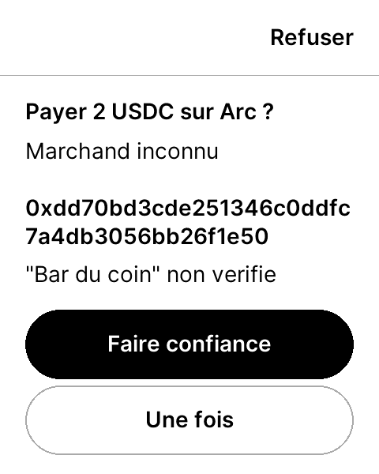
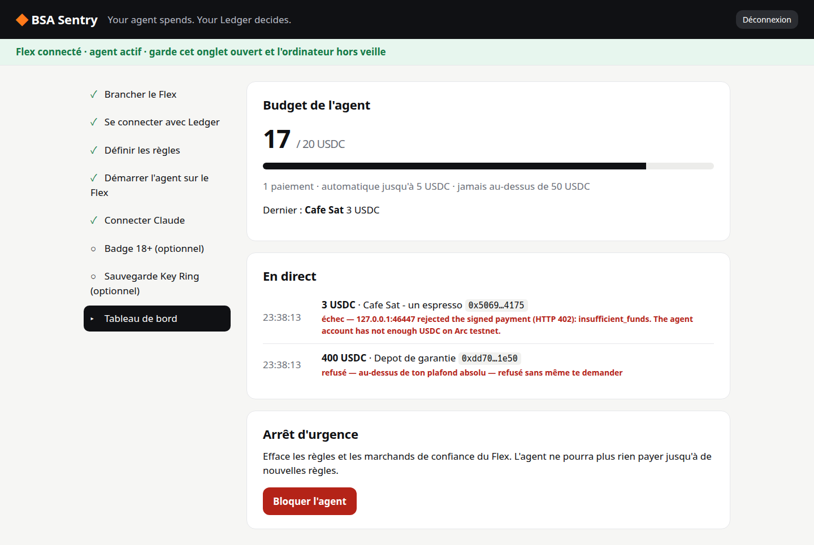

# BSA Sentry

**Your agent spends. Your Ledger decides.**

BSA Sentry puts an AI agent's spending rules **inside the secure element of a Ledger Flex**.
Claude pays for things on the web with [x402](https://x402.org) (HTTP 402, USDC on Arc testnet), and
every payment is decided by a custom Flex app — not by the agent, not by our server, not by a
browser tab that a prompt injection could talk into anything.

Built by the EPFL Blockchain Student Association for the Ledger N3XT Hackathon @ OP3N 2026.

## The boundary between the agent and you

This is the whole product, enforced by a pure function in the device app
([`device-app/core/src/decide.rs`](device-app/core/src/decide.rs), 34 tests):

| The payment… | The Flex… | Example from the demo |
|---|---|---|
| is to a merchant you trust, under your automatic limit, within budget | **signs with no button press** (~1 s) | "Achète-moi un café" — 3 USDC |
| breaks a soft rule (unknown merchant, over the automatic limit, budget or count spent) | shows an **orange screen**: amount, full address, what the agent claims (marked *unverified*), why it is asking — **Refuser / Une fois / Faire confiance**; 60 s of silence = refused | the restaurant, 20 USDC; a new bakery |
| is above your absolute ceiling, on another chain or token, or the agent is not armed | **refuses outright** — a tap cannot override it | a prompt-injected "mandatory 400 USDC deposit" |

The agent can only *request*. The server can only *relay*. Only the Flex signs, and it builds every
digest itself from the raw payment fields: there is no "sign this hash" command.

## What it looks like

| On the Flex | On the website |
|---|---|
|  |  |

Real settlements on Arc testnet, produced by the automated end-to-end runs:
[first coffee](https://explorer.testnet.arc.io/tx/0x446f860eae50ad4d961991d27defe256ebeeefe1816615d8d1857aefe4077a27) ·
[wine with the 18+ badge verified](https://explorer.testnet.arc.io/tx/0x2dba9cc4846a505d5b934ca75fa9667b9c296df07ccac9e5a4f4ed811af4e4e3) ·
[coffee after a wipe and a one-tap restore](https://explorer.testnet.arc.io/tx/0x199cd1f73f8a736b11a6993a8e879fd9ebda90de1d32397f69e2cf6e6ae9df2a).

## How it fits together

```mermaid
flowchart LR
  C[Claude on claude.ai] -- "MCP x402_fetch (OAuth)" --> S[BSA server]
  S -- "GET -> 402" --> M[x402 merchant]
  S -- "WebSocket: sign_payment" --> T[BSA Sentry tab in Chrome]
  T -- "WebHID / DMK: PAY" --> F[Ledger Flex<br/>BSA Sentry app<br/>decide&#40;&#41;]
  F -- "signature or refusal + reason" --> T --> S
  S -- "retry with PAYMENT-SIGNATURE" --> M
  M -- "/verify /settle" --> FA[our facilitator]
  FA -- "transferWithAuthorization" --> A[(Arc testnet<br/>USDC)]
```



There is **no local daemon**: the user keeps one Chrome tab open with the Flex plugged in. Full
specification: [`docs/ARCHITECTURE.md`](docs/ARCHITECTURE.md).

## The Ledger primitives we actually implemented

| Primitive | What we built with it |
|---|---|
| **Custom Flex app** (`ledger_device_sdk`, Rust) | 11 APDUs; the spending policy in NVM; EIP-712 digests computed on-device; the 3-choice orange screen with a 60 s deny-by-default on the NBGL C layout API |
| **Ledger signer over the DMK** (WebHID) | the browser bridge: one in-flight APDU, 120 s timeouts, click-free reconnect |
| **Ledger Key Ring** (LKRP) | the rules and the 18+ badge backed up encrypted under the user's seed; a wiped Flex is restored with one review |
| **Speculos** | 57 device integration tests and every e2e run, with simulated taps |

What it was like to build on them, bluntly: [`docs/DX_NOTES.md`](docs/DX_NOTES.md).

## Optional: an 18+ badge without giving away who you are

A merchant can require `age_over_18`. The user scans a QR with their **EU Digital Identity Wallet**
(Procivis One); only the birthdate is requested, "18 or older" is computed and the birthdate is
dropped. The Flex binds the result to the user's Ledger account and delegates it to *its own*
agent. Our facilitator re-verifies the whole chain on every payment. Nothing personal is stored.
Details: [`docs/EUDIW.md`](docs/EUDIW.md).

## Security invariants

1. Rules change only through an on-device review and a tap.
2. The device builds every digest from raw fields; no "sign this hash" command exists.
3. Payees match on the address; labels are display-only; "Une fois" never adds a payee.
4. Spend counters are persisted before a signature leaves the device.
5. The identity key (`0xMAIN`) signs only Login, Bind and AgentDelegation, always with a tap.
6. The server can only request; the facilitator re-verifies credentials and their link to the payer.
7. OAuth tokens only allow requesting payments, and are revocable.
8. No personal data is stored anywhere; the vault holds ciphertext only.

Each has tests; see [`CLAUDE.md` §7](CLAUDE.md) and `docs/PROGRESS.md`.

## Run it locally

Prerequisites: Linux or macOS, Docker, Node 22 + pnpm, Google Chrome (WebHID; not snap Chromium).

```sh
pnpm install
cp .env.example .env && pnpm keys        # fresh testnet keys + a Speculos seed (never commit .env)
pnpm balances                            # fund the treasury at faucet.circle.com (Arc testnet), then:
pnpm fund <your 0xAGENT> 10

make device                              # build the Flex app in Ledger's Docker image
scripts/speculos.sh start --fresh        # or plug a real Flex and: make load

pnpm --filter @bsa-sentry/server start           # :8787 — server first (the merchants ask it /supported once)
pnpm --filter @bsa-sentry/merchants start        # :4021
pnpm --filter @bsa-sentry/web dev                # :5173, open in Chrome
pnpm tunnel 8787                                 # public URL for the claude.ai connector
```

Load on a real Flex (developer mode, on the dashboard, Ledger Live closed): `make load`, enter
your PIN, accept the "non-genuine" warning (normal for a sideloaded app).

## Tests

```sh
pnpm test                 # 500+ TypeScript tests (contracts, signer, bridge, server, merchants, web logic)
make test                 # + 88 Rust tests of the device logic, on the host
pnpm test:speculos        # 57 device integration tests (Speculos must be running)
pnpm test:web             # Playwright against the real server, with a software Flex
E2E=1 pnpm e2e            # the full demo, twice, on Speculos + the real Arc testnet
```

## Repository

```
device-app/core     the decision and the encodings, no_std, host-tested
device-app/app      the Flex app (from Ledger's app-boilerplate-rust)
packages/types      the frozen contracts (EIP-712, APDU, policy, relay), with golden fixtures shared with Rust
packages/sentry-signer   the signer kit on the DMK (WebHID, Speculos, node-hid)
apps/server         auth, OAuth 2.1, MCP, relay, agent API, facilitator, /age, /vault
apps/merchants      the demo x402 merchants
apps/web            the website and the bridge
```

Pre-existing code (Ledger's boilerplate, our own feasibility tests from Oct 10–11, the team's EUDIW
integration) is disclosed in [`docs/PREEXISTING.md`](docs/PREEXISTING.md).
